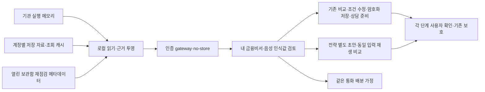

## 2026-10-11 추가 재점검

FC 내부 연결 완료와 개인 종합 자산관리 완성은 다르다. [현재 구현·재현 결함·WM 후속 원장](V39211_WEALTH_MANAGEMENT_AUDIT.md)을 추가 정본으로 사용한다. 이번에는 절세/비과세/구독/복합 목적의 안내와 세금 계산 연결, 세무 답변·가정 비교 결함을 수정했다. 자동 장기 자산계획·개인 절세 최적화·가계 전체 자산 자동 수집을 새로 완료했다고 표시하지 않는다.

# 3.9.2.11 통합 금융비서 개발·인수 원장

2026-10-11 스크린샷 사용성 재점검: 이전 검사는 메뉴 연결 중심이었고 첫 사용 안내·시각·미확인 카드·기관 이동 확인이 부족했다. 첫 화면을 질문→이유 확인→다음 화면의 3단계로 정리하고 중복 음성 진입을 제거했다. 시각은 기기 시간대와 날짜·초를 표시하며 원본 UTC는 상세에 유지한다. 미준비/정지/미관측과 조회 실패·실제 차단을 구분하고, 기관 카드는 해당 기관 상세로 이동한다. 비중 입력은 표로, 전략 기록 없음은 준비 화면으로 안내한다. renderer `3.9.2.11-ui.20261011.2`. [사용성 검토](V39211_COMPANION_USABILITY_REVIEW.md), [이번 검증](../reports/v39211-companion-usability-20261011/validation.json). 아래 이전 검사는 당시 입력 지문의 이력이다.

2026-10-11 금융비서 UI 재점검: 상단 공통 진입점과 기존 5개 서비스 분리를 유지한다. 기본 회색 버튼의 스타일 누락, 내부 선택 업무 표시, 창 안 키보드 초점을 보완했다. renderer `3.9.2.11-ui.20261011.1`. [역할·메뉴·실행 범위](V39211_COMPANION_INFORMATION_ARCHITECTURE_REVIEW.md), [최신 검증](../reports/v39211-companion-ia-20261011/validation.json). 아래 기존 검사 수치는 당시 지문에 대한 이력이다.

2026-10-11 배포 순서 정정: Windows 자동 빌드·출처·기본 설치 확인 → 사용자 릴리즈·테스터 배포 → 테스터 24/72시간 PAPER 검증 → 운영자 결과 취합·후속 조치. 외부 인수 대기는 기존 manifest에 기록하며 stable 게시를 막는 새 조건을 추가하지 않는다. [Windows 실행·담당·기록 양식](V39211_WINDOWS_TESTER_HANDOFF.md).

2026-10-11 후속: 고객의 코인·주식 국면 비교 질문을 일반 어시스턴트/금융비서 공통 로컬 안내에 연결했다. 실제 무거래 질문은 기존 기관 실행 근거 진단이 우선이다. [국면 기준](V39211_MARKET_REGIME_GUIDE.md), [최신 재검사·출시 판정 및 사이트 계획](V39211_RELEASE_REVIEW_AND_DISCOVERY.md). 아래 10일 검사 수치는 당시 지문에 대한 이력이며 최신 추가 변경은 별도 보고서에서 확인한다.

2026-10-10 KST. 사용자가 **외부 기관 계약·실계좌·실견적 API 없이 가능한 내부 기능 전체를 기존 기반에 연결**하는 범위를 선택했다. 공개 기반은 3.9.2.10이고 현재 소스 후보는 3.9.2.11이다. 이전 [거래 신뢰성 수정](V39211_TRADING_ENTRY_UPDATE.md)을 포함한다. 이 문서는 신규 개발의 범위·기술 구조·완료 증거를 기록한다.

## 소스 대조 결과

생활금융의 목적 탐색·결정적 비교·조건 수정·암호화 저장·상담 준비/회신 구조, 전략 입력·버전·승인·재생/PAPER, 음성 입력·읽기, 기관별 거래 근거와 자산 조회 기반은 구현돼 있다. 현재 구현을 새로 만들지 않는다. 다음 설명은 정정한다.

- 보험 4개 회사·7개 자료는 내장 **탐색용 편집 자료**이며 현재 유효한 개인 견적·전체 시장 상품 수가 아니다. 실행 시 저장 자료와 유효기한을 확인한다.
- 일반 어시스턴트의 시장 답변은 실시간 뉴스 자동 수집이 아니다. 현재 저장한 시세·뉴스·일정과 공급원·기준시각이 확인된 범위만 연결한다.
- 포트폴리오의 상관관계는 자료 부족 상태를 포함하는 기반이다. 수익률 시계열이 없으면 상관계수나 위험 감소량을 만들지 않는다.
- 음성 입력 구현과 주요 업무의 완전한 음성 실행은 다르다. 입력·조건 검토·화면 연결을 제공하되 저장·주문·LIVE 승격은 별도 확인 절차다.
- 기존 거래 수정의 로컬 회귀 통과는 Windows 설치본·모든 PC·장시간 무결함 증명이 아니다. ‘앞으로 오류가 절대 없다’는 완료 기준을 사용하지 않고 아래 재현·회귀·실환경 인수로 판단한다.

## 개발 범위와 검증 기준

|ID|기능|재사용·연결|필수 검증|
|---|---|---|---|
|FC-01|통합 진단|기관별 `entry_health`·`entry_activity` → 질문 답변·운용 요약|기관/모드 분리, 수치·기준·시각, 오류/정상 HOLD 구분, 조회 실패를 정상으로 표시하지 않음|
|FC-02|통합 금융비서|기존 질문 분류·금융 목적 탐색 → 조건 검토 → 기존 비교·저장·상담 화면|질문/조건 유지, 복수 의도 확인, 기존 저장·동의·접수 보호 유지|
|FC-03|오늘의 금융 브리핑|저장 시장/뉴스/일정·LIVE 조회 캐시·등록 가계부·저장 계획 재점검|외부 호출 없이 부분 실패·노후·미기록 표시, 조회 시각과 원본 기준시각 구분|
|FC-04|대화형 비교·설계|기존 결정적 조건 해석·변경 전후 재계산|명시한 숫자만 적용, 모호한 ‘부담 줄이기’는 추가 질문, 미확인 비용은 null|
|FC-05|근거 표시 통일|공통 근거 카드 → 기존 기능의 세부 근거 화면|출처·자료 종류·기준시각·기한·가정·미확인 항목, 갱신 실패로 기한 연장 없음|
|FC-06|내 자산 중심 질문|조회 캐시의 명시 종목 → 저장 뉴스·이벤트 종목 매핑|원문 제목의 부분 일치로 종목을 추정하지 않음, 미연결 ETF 구성 자료를 생성하지 않음|
|FC-07|대화형 전략 실험|기존 전략 상담·별도 초안 → 검토·버전 저장·동일 재생 조건 비교|원본/승인 불변, 비용·기간·시간봉 비교 기준 확인, 자동 적용·LIVE 승격 없음|
|FC-08|만기·갱신·재확인|기존 암호화 계획·재점검 규칙 → 브리핑|잠금 상태에 내용 없음, 잠금 기한 연장 없음, 앱 안 알림과 외부 전송 구분|
|FC-09|배분 미리보기|명시적 통화·가치·현재/목표 비중·사용자 입력 비용 → 결정적 비교|통화 합산/파생 노출 혼입 금지, 비중 합계·유한값·표본 확인, 주문 없음|
|FC-10|음성 과업 연결|기존 음성 입력/읽기 → 동일 질문·검토·다음 행동|권한 거절/미지원 대응, 음성 인식값 재확인, 저장·주문 자동 호출 없음|

완료 표시는 실행 로그와 대응하는 경우에만 갱신한다. 기존 기능의 구현을 신규 개발 전체 완료로 집계하지 않는다. 구체적인 실제 수치와 남은 항목은 [TEST_STATUS](TEST_STATUS.md) 및 이번 전용 검증 보고서에 남긴다.

## 기술 설계

인증된 로컬 gateway에 금융비서 조회·질문·배분 미리보기 계약을 추가한다. 거래 명령·원장 쓰기·외부 Provider/기관 호출과 분리된 읽기 경로다. 메인에서 금융비서를 열면 저장된 근거의 브리핑을 보여주고 질문 결과에 검토 화면으로 가는 닫힌 집합의 행동을 제공한다. 금융 비교는 기존 `ProductIntelligenceWorkspace`, 전략은 기존 상담·스튜디오를 재사용한다.

저장 재생 비교는 실제 입력 SHA-256 `comparison_basis`가 같은 서로 다른 버전에 한정한다. 과거 결과에 지문을 소급 생성하지 않는다.

공통 근거는 원본 기준시각·출처·자료 종류·계산 가정·미확인 사항을 유지한다. 새 조회 시각으로 오래된 원본을 최신으로 바꾸지 않는다. 계정 변경·닫기·느린 응답 도착 때 이전 사용자 자료를 표시하지 않는다. 보험 보관함은 기존 잠금 기한을 확인하며 브리핑 때문에 해제하거나 연장하지 않는다. 중첩 외부 오류·키·원본 보험 문서를 답변에 자동 첨부하지 않는다.

금융비서 연결만으로 최신 금융상품 공급·개인 대출 금리/보험료·은행/카드 전체 자동 수집·상담사 실수신·은행 송금·보험 가입·온체인/커뮤니티 데이터 수집이 완성되지는 않는다. 공급 계약·이용 권한·운영 책임자·기관 인증과 실접수/회신 검증을 확보한 뒤 기존 인터페이스에 연결한다.

## 출시 검증 경계

현재 단계: FC-01~FC-10 내부 연결 구현·로컬 검증 완료. Windows 설치기·게시·실설치 인수는 미실시. Python/Node·문서·TypeScript/Vite·실제 빌드 합성 브라우저·기관별 기존 거래 회귀를 실행하고 결과에 따라 갱신한다. 공개 .10 설치기와 사용자 원본 자료를 보존한다. .11 Windows 새 설치기·.10→.11 실제 업데이트/.10 롤백·마이크 실제 환경·실제 기관/Provider·24/72시간 인수는 별도이며 결과 없이 통과 처리하지 않는다.

## 구현·검증 결과와 다음 인수

|범위|이번 완료 근거|실환경 경계|
|---|---|---|
|FC-01|메인 금융비서와 기존 일반 어시스턴트가 같은 기관별 실행 진단을 조회. 기관·PAPER/LIVE·실제 기준·미수신 분리|실제 LIVE 주문·사용자 PC 재개는 별도|
|FC-02/04|명시 조건/원 질문을 기존 비교로 전달, 모호한/복수 의도 확인, 기존 결정적 조건 수정·재계산·암호화 저장·상담 준비 재사용|개인 확정 견적·실상담 접수는 별도|
|FC-03/05/06|읽기 전용 로컬 브리핑, 원본 시각·기한·버전·가정·부분 실패·LIVE 캐시와 뉴스 각각의 근거 표시, 명시 종목 일치만 연결|미연결 뉴스 공급·ETF 구성 자료는 미확인|
|FC-07|별도 질문 초안과 선택적 AI 상담 분리, 11기관 합성 재생의 실제 입력 지문 기록·같은 입력만 저장 결과 대조|현재 재생 결과 비교가 미래 성과·PAPER/LIVE 인수를 대신하지 않음|
|FC-08|보관함 잠금/기한 확인, 재점검 메타데이터만 읽고 잠금 기한/원본 불변|앱 안 열기/새로고침 때 점검, 외부 푸시·이메일 없음|
|FC-09|같은 통화·유한값·중복/합계 검증, HHI·이동 금액·입력 비용 계산, 비용 미입력 null|파생 노출·다통화·실제 잔고/주문량 자동 산정 없음|
|FC-10|명시 음성 명령을 표시·확인한 뒤 비교 열기/조건 수정·재계산/계획 저장/화면 이동. 기존 보관함 잠금·확인 보호 유지, 부정 명령 취소|브라우저 합성 STT 검증이며 실제 마이크 인수는 미실시|

음성 예: 질문 후 “비교 화면 열어줘”, 비교 안에서 “기간 24개월로”, “현재 조건 비교해줘”, “현재 계획 저장해줘”, “배분 미리보기 열어줘”, “자산 화면 열어줘”. 인식한 명령·금액·기간을 검토하고 「명령 확인」을 눌러야 실행한다. 보관함이 잠겨 있으면 저장하지 않는다. 자유문장 전체나 송금·가입·주문·전략 승인을 음성으로 자동 실행하는 기능은 제공하지 않는다.

Python 5,675개/Node 73개/실제 빌드 합성 React 75개 통과. [상세 실행 증거](../reports/v39211-companion-20261010/validation.json), [테스트 상태](TEST_STATUS.md). 공개 .10 설치기·manifest 및 고객 원본은 보존했다. 이번 결과는 소스 후보·로컬 검증이며 Windows 설치기 생성/게시·실제 .10→.11 업데이트/롤백·실마이크·24/72시간 인수와 구분한다. 공급 계약·실견적·실수신·송금/가입의 외부 의존성은 위 기술 설계대로 유지한다.
